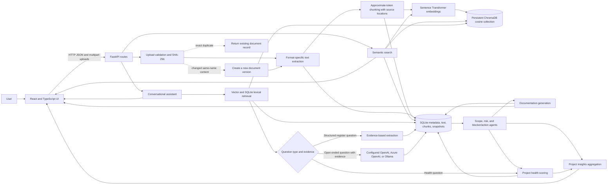
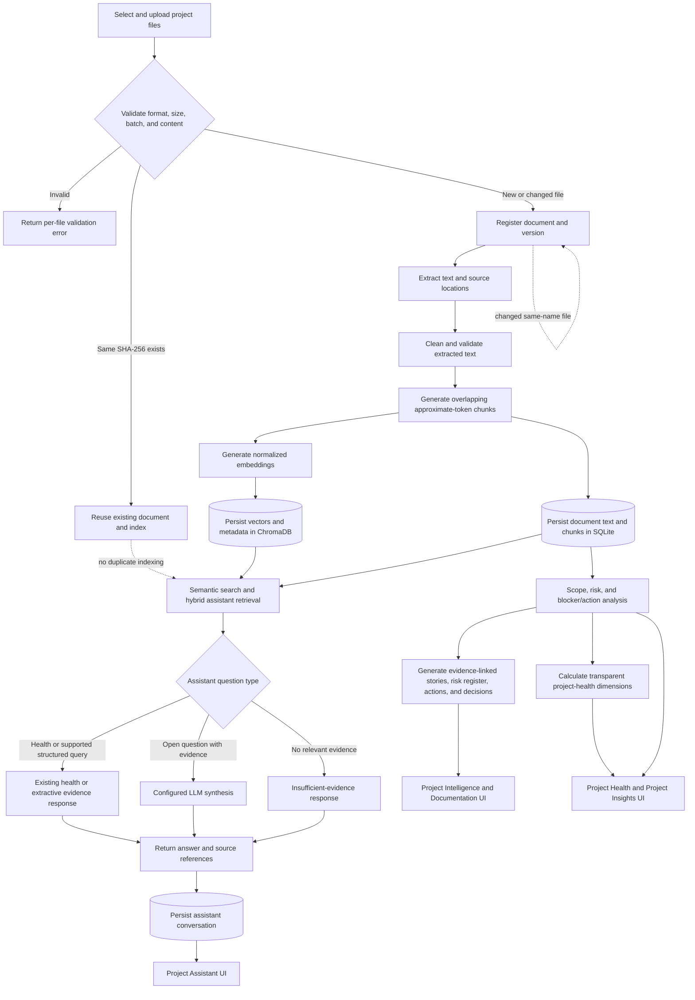

# Development of AI-Driven Enterprise Project Intelligence & Risk Management Platform

A local-first project intelligence workspace that turns project documents into searchable evidence, rule-based delivery insights, and an evidence-grounded conversational assistant. The application combines document processing, semantic retrieval, transparent project-health scoring, and source-linked project records in one React and FastAPI application.

> **Implementation note:** Milestone 2 agents and project-health calculations use deterministic, rule-based extraction. Configurable language models are used by the assistant for open-ended questions; they do not power the Milestone 2 agents.

## Table of contents

- [1. Project overview](#1-project-overview)
- [2. Technologies](#2-technologies)
- [3. System architecture](#3-system-architecture)
- [4. Milestone 1: document processing and retrieval](#4-milestone-1-document-processing-and-retrieval)
- [5. Milestone 2: project intelligence agents](#5-milestone-2-project-intelligence-agents)
- [6. Milestone 3: advanced project intelligence](#6-milestone-3-advanced-project-intelligence)
- [7. Milestone 4: project insights and incremental uploads](#7-milestone-4-project-insights-and-incremental-uploads)
- [8. AI agents: inputs, processing, and outputs](#8-ai-agents-inputs-processing-and-outputs)
- [9. Application workflow](#9-application-workflow)
- [10. User interface](#10-user-interface)
- [11. Repository structure](#11-repository-structure)
- [12. Installation and setup](#12-installation-and-setup)
- [13. API reference](#13-api-reference)
- [14. Testing and validation](#14-testing-and-validation)
- [15. Security and error handling](#15-security-and-error-handling)
- [16. Limitations and future enhancements](#16-limitations-and-future-enhancements)
- [17. Conclusion](#17-conclusion)

## 1. Project overview

### Problem statement

Enterprise project facts are commonly spread across meeting notes, project plans, spreadsheets, presentations, and status reports. Manually searching these files makes it difficult to establish what is current, locate the evidence behind a decision, and consistently identify delivery risks, dependencies, blockers, and responsibilities.

### Existing system

Traditional project tracking relies on separate files, status meetings, spreadsheets, and manually prepared reports. This can leave information fragmented, make document review slow, delay risk and blocker discovery, and make it difficult to trace a summary back to the source evidence. This application complements those workflows with a searchable local project record; it does not replace an organization's project-management system.

### Proposed solution

This platform provides a local workspace for ingesting mixed-format project documents, extracting and indexing their text, and exposing the resulting evidence through document browsing, semantic search, project analysis, structured documentation, health scoring, and conversational question answering. Findings include source references where the source text can be matched to an indexed chunk.

### Objectives and scope

- Accept supported project files and preserve document and chunk locations.
- Create persistent text and vector indexes for local semantic retrieval.
- Surface scope, risk, blocker, action, and decision information from indexed project sources.
- Present transparent health factors instead of opaque or unsupported scores.
- Support incremental additions and same-name document versions without losing earlier indexed versions.
- Provide a source-backed assistant, with an explicitly configured LLM provider for open-ended synthesis.

The current scope is a single-user local application. It does not provide authentication, shared-user permissions, OCR, statistical forecasting, or background job processing.

### Key features

- Multi-file upload with extension, size, batch, and extracted-content checks.
- Format-aware extraction, location-preserving chunking, normalized embeddings, and persistent ChromaDB storage.
- Filterable document and chunk explorers, semantic search, and embedding-vector inspection.
- Scope and deliverable, risk, and blocker/action analysis with evidence references.
- Saved user stories, risk-register entries, action items, and pending decisions with CSV and JSON export.
- Three-dimension project health scoring with configurable-data-driven factors, explicit weights, and an insufficient-data state.
- A conversational assistant with hybrid retrieval, selected-document filtering, source citations, and persistent session history.
- A combined Project Insights page and an overview dashboard that use live backend responses.
- Exact-content duplicate detection and filename-based document version history.

### Target users and expected outcomes

The application is intended for project managers, delivery leads, PMO analysts, product owners, and teams that need to review local project records. Expected outcomes include faster discovery of project evidence, more consistent review of delivery signals, and easier traceability from an insight back to the source document. These are intended benefits, not measured performance claims.

## 2. Technologies

Versions below are those declared in the repository manifests unless marked as the validation runtime. Dependency ranges may resolve to a newer compatible release when installed.

| Area | Technology | Version/configuration | Purpose |
|---|---|---|---|
| Frontend | React | `^19.0.0` | Component-based user interface |
| Frontend | TypeScript | `~5.7.3` | Typed frontend code and build checks |
| Frontend | Vite | `^6.1.0` | Development server and production bundling |
| Frontend | React Router | `^7.1.5` | Client-side page routing |
| Frontend | Axios | `^1.8.4` | HTTP API client |
| Frontend | lucide-react | `^0.468.0` | Interface icons |
| Backend | Python | Project supports Python 3.11+; validation runtime: 3.14.0 | Backend implementation |
| Backend | FastAPI | `>=0.115,<1` | REST API and request validation |
| Backend | Uvicorn | `>=0.34,<1` | ASGI development server |
| Backend | Pydantic | `>=2.10,<3` | API input and response schemas |
| Configuration | python-dotenv | `>=1.0` | Loads the repository-root `.env` configuration |
| Database | SQLite | Python standard library | Document metadata, text, chunks, health snapshots, generated records, and assistant turns |
| Vector storage | ChromaDB | `>=1.0` | Persistent vector collection and cosine-distance search |
| Numerical processing | NumPy | `>=2.1` | Embedding-array validation and conversion |
| Embeddings | sentence-transformers | `>=4.1` | Shared local document/query embedding model |
| Default embedding model | `sentence-transformers/all-MiniLM-L6-v2` | `EMBEDDING_MODEL` override | Encodes document chunks and user queries |
| LLM providers | OpenAI, Azure OpenAI, Ollama | Explicit `AI_PROVIDER` selection | Open-ended assistant responses only |
| Provider clients | OpenAI Python SDK; HTTPX for Ollama | OpenAI SDK `>=1.68,<3`; HTTPX `>=0.28` | Provider requests, timeout handling, and connection reuse |
| Document processing | PyMuPDF, python-docx, python-pptx | Declared in `backend/requirements.txt` | PDF, Word, and PowerPoint extraction |
| Document processing | pandas, openpyxl, xlrd | Declared in `backend/requirements.txt` | Spreadsheet extraction |
| Document processing | BeautifulSoup, striprtf, defusedxml | Declared in `backend/requirements.txt` | HTML, RTF, and safe XML parsing |
| Testing | pytest, HTTPX, FastAPI TestClient | pytest `>=8.3`; HTTPX `>=0.28` | Backend unit and API integration tests |
| Build validation | TypeScript compiler and Vite | Frontend manifest | Type-check and production frontend build |

The Python dependency declarations are in [`backend/requirements.txt`](backend/requirements.txt) and [`backend/pyproject.toml`](backend/pyproject.toml); frontend versions are in [`frontend/package.json`](frontend/package.json) and the lockfile. Validation tool versions and results are recorded in [Testing and validation](#15-testing-and-validation).

## 3. System architecture

The React frontend communicates with the FastAPI backend over HTTP/JSON. File uploads use multipart form data. The backend separates API routes, Pydantic schemas, configuration, SQLite persistence, and processing/retrieval services.

SQLite is the source of truth for document records, extracted text, chunk text and locations, analysis/generation snapshots, project-health calculations, and assistant history. ChromaDB persists the chunk embeddings and search metadata in the `document_chunks` collection using cosine distance.

Milestone 2 agents and project-health scoring analyze extracted text and source-linked SQLite chunks; they do not require semantic top-k retrieval. The assistant uses a separate retrieval flow that combines ChromaDB candidates with lexical candidates from SQLite, reranks and deduplicates results, and verifies source chunks before constructing context. Health questions use the health service; supported structured questions can be answered from retrieved evidence without an LLM. Other questions use the explicitly configured LLM with selected evidence as context.



### Retrieval-augmented assistant flow

1. Validate the question and optional indexed-document selection.
2. Load recent session history and use it to resolve follow-up context.
3. Embed the query using the same model as document chunks.
4. Retrieve semantic candidates from ChromaDB and lexical candidates from SQLite.
5. Rank candidates using sentence relevance and semantic distance, deduplicate near matches, and verify source records.
6. Answer health and supported structured-register questions from the application’s existing analysis/evidence; otherwise pass selected evidence to the configured LLM.
7. Return the answer mode and document/chunk references, then persist the conversation turn.

## 4. Milestone 1: document processing and retrieval

### Upload and validation

The upload endpoint accepts a batch of files. Current defaults are 25 files per batch, 50 MB per file, 10,000,000 extracted characters per document, and 20,000 chunks per document. The application checks extensions against the supported-format registry, rejects empty files, creates UUID-based stored filenames, and records a SHA-256 hash.

### Supported formats

The parser registers the following extensions:

| Category | Extensions |
|---|---|
| Office and PDF | `.pdf`, `.docx`, `.doc`, `.pptx`, `.ppt` |
| Spreadsheets | `.csv`, `.xlsx`, `.xls` |
| Text and markup | `.txt`, `.md`, `.rtf`, `.html`, `.htm`, `.xml`, `.json`, `.log` |
| Source files | `.py`, `.js`, `.ts`, `.tsx`, `.jsx`, `.java`, `.c`, `.cpp`, `.h`, `.css`, `.sql` |

Legacy `.doc` and `.ppt` files require LibreOffice (`soffice` or `libreoffice`) on `PATH`; legacy `.xls` uses `xlrd`. PDF extraction uses embedded text and does not perform OCR, so scanned or image-only PDFs may fail with an extraction error.

### Ingestion and indexing

1. Store the uploaded bytes and calculate SHA-256 while enforcing the per-file size limit.
2. Extract text using the matching parser. PDF pages, presentation slides, spreadsheet rows, and plain-text line numbers are retained as source-location metadata where available. Word paragraphs and table rows are extracted.
3. Clean extracted segments, enforce the extracted-character limit, and save the text and processing status in SQLite.
4. Split the segments into overlapping chunks using the configured approximate word/token pattern. Defaults are 500 tokens per chunk and 50 tokens of overlap; these values are not computed with the embedding model tokenizer.
5. Embed each chunk with the configured sentence-transformers model. Embeddings are normalized and stored in ChromaDB with document, file-type, chunk, and source-location metadata. Chunk records and embedding/indexing status are stored in SQLite.
6. Mark the document indexed only after embedding and vector upsert succeed.

Semantic search embeds a query with the same model, queries ChromaDB by cosine distance, and returns matching chunk text, source, location, distance, and embedding-model metadata. It is retrieval-only and does not generate an LLM answer.

### Exploration pages

- **Documents** lists processing status, file metadata, current/version history, and indexed chunk counts.
- **Document details** displays extracted text, source chunks, and processing metadata.
- **Chunk Explorer** filters and browses persisted chunks and their source locations.
- **Embeddings** displays vector dimensions and a preview, with an option to load the full vector.
- **Semantic Search** supports top-K retrieval and optional document/file-type filters.

## 5. Milestone 2: project intelligence agents

The three agents use local rule-based text and pattern matching over the extracted text of current indexed project documents. They are not LLM agents. Findings are matched to persisted chunks where possible to attach a filename, excerpt, chunk identifier, and source location. The optional `query` and `top_k` analysis request fields do not change the agents into semantic retrieval or generative workflows.

### 5.1 Scope and deliverables agent

The agent identifies goal/objective statements, deliverable and artifact wording, milestone and deadline statements, responsibilities and owners, dependencies, and progress/status language. Dates are extracted from recognized text patterns. Structured deliverable/milestone information in workbook rows is also inspected. The response includes missing-information notes and source-backed findings when evidence can be linked.

### 5.2 Risk intelligence agent

The risk agent scans for risk, schedule, delay, blocked, dependency, approval, issue, and related language. It assigns `Low`, `Medium`, `High`, or `Critical` based on deterministic keyword and status rules, identifies affected dates/milestones where available, and provides rule-based recommendations. Risk levels are heuristic findings, not probability forecasts; probability and impact are not inferred as measured values.

### 5.3 Blockers and actions agent

The blocker/action agent classifies statements as blockers, pending decisions, or action items using explicit labels and direct wording. It extracts dates, owners/assignees, priority, related tasks or milestones when identifiable. Information not present in the source is left unset rather than invented.

The Project Intelligence page presents these analyses in separate Scope & Deliverables, Risk Intelligence, and Blockers & Actions views. Findings can be opened in a shared detail panel with evidence and a source-document link when a matching chunk exists.

## 6. Milestone 3: advanced project intelligence

### 6.1 Documentation generation

Documentation Generation operates on selected indexed documents and stores a saved generation for that selection. It produces:

- **User stories** when a supported user need or requirement pattern is explicit in the source. It retains role, requirement, benefit wording when present, optional priority and acceptance criteria, and source evidence.
- **Risk register entries** based on the risk agent, with a deterministic category/severity rule and suggested mitigation. Likelihood and impact remain “Not stated in source” unless explicit text supports them.
- **Action items and pending decisions** based on the blocker/action agent, preserving named owners and dates only when found in evidence.

Repeated generation for the same selected document set updates its saved result rather than creating duplicate generations. Unsupported categories remain empty. Results can be exported as CSV or JSON.

### 6.2 Project health scoring

The health service evaluates current indexed documents and reuses the project agents. It excludes README testing-guide documents from the source set. Dimension scores are clamped to 0–100 where applicable.

| Dimension | Weight | Implemented calculation |
|---|---:|---|
| Scope clarity | 35% | 20 points each for identified goals, deliverables, milestones, assigned responsibilities, and explicit requirements (maximum 100). |
| Timeline health | 35% | Starts at 100. Delayed/overdue milestones cost 20 each (maximum penalty 60); schedule risks cost 12 each (maximum 30); dependency/approval risks cost 10 each (maximum 20); milestones with no parseable dates incur 10 points. |
| Blocker health | 30% | Starts at 100. Unresolved blockers cost 25 each (maximum 70); pending decisions cost 10 each (maximum 30); explicitly blocked tasks cost 20 each (maximum 40). Ordinary action items are not blockers. |

When every dimension is available, the overall score is:

```text
overall = scope_clarity * 0.35
        + timeline_health * 0.35
        + blocker_health * 0.30
```

Classification is **Healthy** at 80–100, **Needs Attention** at 60–79, and **At Risk** below 60. If a dimension lacks enough evidence, the overall score is **Insufficient Data** rather than treating missing evidence as healthy. In particular, no timeline evidence or no blocker/decision status does not imply a perfect dimension. Each calculation stores its factors, timestamp, and result in SQLite.

### 6.3 Conversational project intelligence assistant

The assistant uses hybrid retrieval over the existing ChromaDB collection and SQLite chunk records. It applies query-aware lexical terms, semantic distance, sentence relevance, ranking, deduplication, and source-record verification. Optional document filters apply to both retrieval paths. The selected evidence is returned as source references with filenames, excerpts, and locations.

Question handling is explicit:

- Health questions use the existing health calculation and return a health-analysis response.
- Supported structured project-register questions can be answered extractively from matching source rows without an LLM.
- Open-ended questions with evidence use the selected OpenAI, Azure OpenAI, or Ollama provider.
- If there is no relevant evidence, the assistant reports insufficient evidence. If an LLM is required but missing or unavailable, the API reports an error; it does not silently return raw passages as an answer.

Conversation messages are stored in SQLite under a client-generated UUID session ID. Example questions include:

- Are we on track, and which milestones are delayed?
- What are the largest project risks and their source evidence?
- Which blockers or decisions remain unresolved?
- What actions are pending, who owns them, and what due dates are stated?
- What are the major deliverables and dependencies?

**Response-time and retrieval implementation:** the embedding model is loaded lazily and cached behind a lock; startup warms it in the background when indexed documents exist. The assistant embeds only the query, reuses the existing document vectors, limits and reranks semantic/lexical candidates before context construction, caps the provider context, reuses provider clients, and logs per-stage timings. LLM request timeout defaults to 90 seconds; the frontend assistant request timeout is 100 seconds. These are implementation measures, not a latency guarantee.

## 7. Milestone 4: project insights and incremental uploads

### 7.1 Project Insights

`GET /project-insights` creates a fresh response from the existing project-health, scope, risk, and blocker/action services. It combines:

- Overall status and score from the health service; it does not introduce another health formula.
- Scope goals/objectives, deliverables, milestones, responsibilities, dependencies, progress, and missing information.
- Risk findings categorized by deterministic text rules and grouped by their agent severity.
- Action counts for pending, completed, and overdue items. Overdue status is based on a recognized due date before the current date; otherwise an unfinished item is pending.
- Evidence references and mitigation recommendations when available.
- Counts for uploaded, processed, and current indexed documents; risks; blockers; actions; deliverables; and generated documentation items.
- Severity, blocker-resolution, action-status, and milestone-status distributions, plus the latest documentation summary when it was generated for the complete current indexed document set.

The Overview and Project Insights pages render API-backed metrics, health dimensions, risk severity and action-status charts, risk and blocker findings, documentation summaries, scope/deliverable summaries, and milestone status. They refresh on window focus and periodically; loading, request errors, and empty results have explicit UI states. The overview loads document statistics and insights independently, so an insights error does not hide otherwise available document statistics. Timeline risk is displayed as the inverse of the existing timeline-health score.

Risk probability and impact are currently `null` in the Project Insights response and appear as “Not stated”; they are not computed by this endpoint.

### 7.2 Incremental upload, duplicate detection, and versioning

- **Exact duplicate content:** SHA-256 is calculated from uploaded bytes. If that hash already exists, the uploaded temporary copy is removed and the existing document/index record is returned.
- **Changed content with the same filename:** a new document row and version number are created, linked to the preceding current document through `version_of_document_id`. The new file is fully extracted, chunked, embedded, and indexed; unchanged earlier documents are not reprocessed.
- **Current version transition:** only after successful indexing is the newly processed version marked current and the previous same-name version marked non-current. A failed new version remains recorded as failed and does not replace the previous current version.
- **Retrieval and analysis:** semantic retrieval and the agents use current indexed versions, while prior versions and their source files/chunks remain available in document history.
- **Deletion:** the associated vector records, SQLite document/chunk rows, and stored file are removed. If the deleted record was current, the newest remaining indexed same-name version can become current.
- **Project health refresh:** after a newly indexed or updated upload, the upload flow attempts to recalculate and persist project health. A failure is logged and returned as `insights_refresh_error`; successful indexing is not silently described as a failed upload.

Uploads are processed synchronously in the upload request. The application processes a changed file as a new document; it does not compute a byte-level or paragraph-level diff against the previous version.

## 8. AI agents: inputs, processing, and outputs

| Agent/service | Inputs | Processing | Outputs |
|---|---|---|---|
| Scope & Deliverables Agent | Current indexed project documents and their extracted text/chunks | Rule-based matching for goals, objectives, requirements, deliverables, milestones, owners, dependencies, progress, and workbook rows; links findings to source chunks where possible | Scope summary, deliverables, milestones, responsibilities, dependencies, progress, missing-information notes, and evidence references |
| Risk Intelligence Agent | Current indexed project documents and extracted project statements | Rule-based risk phrase detection and deterministic severity/category/recommendation rules; no probabilistic forecasting | Risk findings with severity, recommendations, relevant dates/milestones where found, and source evidence |
| Blockers & Action Items Agent | Current indexed project documents and extracted project statements | Classifies explicit blockers, pending decisions, and action items; extracts owners, dates, priority, or related work only when stated | Blockers, pending decisions, action items, and evidence references |
| Documentation Generation | Selected indexed document IDs; reuses scope, risk, and blocker/action outputs with source text | Creates a saved, source-grounded generation for the selected document set; unsupported output categories remain empty | User stories, risk-register entries, structured actions, pending decisions, and CSV/JSON export |
| Project Health Scoring | Current indexed documents, extracted text, and outputs from the three Milestone 2 agents | Calculates scope clarity, timeline health, and blocker health using the documented weighted formula and evidence-based factors | Dimension scores, overall score/classification when sufficient evidence exists, findings, and recommended actions |
| Conversational Project Intelligence Assistant | A question, session UUID, optional document filter, and retrieval limit | Combines ChromaDB semantic candidates with SQLite lexical candidates, reranks and verifies source chunks, then routes health and supported register questions or calls the configured LLM for open-ended answers | Answer mode, answer, source references, and persisted conversation history; insufficient evidence or provider errors are reported explicitly |

The Scope, Risk, and Blockers/Actions agents are deterministic extraction services rather than autonomous LLM agents. Documentation Generation and Project Health orchestrate these outputs with indexed evidence. The assistant uses an LLM only for open-ended synthesis when a provider is explicitly configured.

## 9. Application workflow



## 10. User interface

The interface uses a responsive enterprise workspace layout with grouped sidebar navigation, a sticky top bar, API/AI status indicators, cards and tables, loading/empty/error states, and evidence panels. Styling uses a light gray workspace, white surfaces, a dark navy sidebar, and indigo/cyan accents. The theme is implemented in CSS; it is not a user-selectable dark/light theme.

| Page | Route | Main purpose |
|---|---|---|
| Overview dashboard | `/` | Document, index, agent, risk, action, and health summaries plus recent uploads |
| Documents | `/documents` | Search/filter documents, view status and versions |
| Document details | `/documents/:documentId` | Extracted text, metadata, chunk list, and source references |
| Document upload | `/upload` | Upload files and view processing outcomes |
| Semantic search | `/search` | Retrieve source-linked chunks by query |
| Scope & Deliverables | `/project-intelligence?view=scope` | Review scope agent output |
| Risk Intelligence | `/project-intelligence?view=risks` | Review risk findings and evidence |
| Blockers & Actions | `/project-intelligence?view=blockers` | Review blockers, decisions, and actions |
| Documentation Generation | `/documentation` | Generate, review, and export project records |
| Project Health | `/project-health` | Recalculate and inspect dimension scores, factors, and findings |
| Project Assistant | `/assistant` | Ask project questions and inspect retrieved evidence |
| Project Insights | `/project-insights` | Review combined health, risk, action, and scope summary |
| Chunk Explorer | `/chunks` | Filter and inspect indexed text chunks |
| Embeddings | `/embeddings` | Inspect vector dimensions, preview, or full vector |
| System status | `/settings` | Inspect backend/provider status and supported formats |

The frontend uses a keyboard shortcut (`Ctrl+K` or `Cmd+K`) to open Semantic Search. The interface polls backend health every 30 seconds. Project Assistant conversation history is keyed by a session UUID stored in browser session storage and persisted by the backend.

## 11. Repository structure

```text
.
|-- README.md
|-- .env.example
|-- .gitignore
|-- backend/
|   |-- pyproject.toml
|   |-- requirements.txt
|   |-- app/
|   |   |-- __init__.py
|   |   |-- main.py
|   |   |-- api/
|   |   |   |-- __init__.py
|   |   |   `-- routes/
|   |   |       |-- __init__.py
|   |   |       |-- analysis.py
|   |   |       |-- assistant.py
|   |   |       |-- chunks.py
|   |   |       |-- documentation.py
|   |   |       |-- documents.py
|   |   |       |-- health.py
|   |   |       |-- project_health.py
|   |   |       |-- project_insights.py
|   |   |       `-- search.py
|   |   |-- core/
|   |   |   |-- __init__.py
|   |   |   `-- config.py
|   |   |-- database/
|   |   |   |-- __init__.py
|   |   |   `-- db.py
|   |   |-- models/__init__.py
|   |   |-- schemas/
|   |   |   |-- __init__.py
|   |   |   |-- analysis.py
|   |   |   |-- api.py
|   |   |   `-- milestone3.py
|   |   `-- services/
|   |       |-- __init__.py
|   |       |-- assistant.py
|   |       |-- chunking.py
|   |       |-- document_parser.py
|   |       |-- documentation.py
|   |       |-- embedding_service.py
|   |       |-- pipeline.py
|   |       |-- project_agents.py
|   |       |-- project_health.py
|   |       |-- text_cleaner.py
|   |       `-- vector_store.py
|   `-- tests/
|       |-- test_api.py
|       |-- test_milestone3.py
|       |-- test_processing.py
|       `-- test_project_agents.py
|-- frontend/
|   |-- package.json
|   |-- package-lock.json
|   |-- tsconfig.json
|   |-- tsconfig.app.json
|   |-- tsconfig.node.json
|   |-- vite.config.ts
|   |-- index.html
|   `-- src/
|       |-- App.tsx
|       |-- main.tsx
|       |-- components/
|       |   |-- Milestone3Shared.tsx
|       |   `-- Shared.tsx
|       |-- layouts/AppLayout.tsx
|       |-- pages/
|       |   |-- ChunkExplorer.tsx
|       |   |-- Dashboard.tsx
|       |   |-- DocumentDetails.tsx
|       |   |-- DocumentationGeneration.tsx
|       |   |-- Documents.tsx
|       |   |-- EmbeddingsExplorer.tsx
|       |   |-- ProjectAssistant.tsx
|       |   |-- ProjectHealth.tsx
|       |   |-- ProjectInsights.tsx
|       |   |-- ProjectIntelligence.tsx
|       |   |-- SemanticSearch.tsx
|       |   |-- Settings.tsx
|       |   `-- UploadDocuments.tsx
|       |-- services/api.ts
|       |-- styles.css
|       |-- types.ts
|       `-- vite-env.d.ts
`-- data/                       Local runtime files; ignored by Git
    |-- uploads/
    |-- extracted_text/          Created at startup; extracted text is persisted in SQLite
    |-- metadata/platform.sqlite3
    `-- chroma_db/
```

| Path | Responsibility |
|---|---|
| `backend/app/main.py` | FastAPI application, CORS middleware, router registration, startup initialization, and model warm-up |
| `backend/app/api/routes/` | Health, upload/document, chunk, search, agent, assistant, documentation, health, and insights endpoints |
| `backend/app/core/config.py` | Environment-based paths, processing limits, CORS, embedding model, and AI provider configuration |
| `backend/app/database/db.py` | SQLite schema initialization, migrations, connections, and row conversion |
| `backend/app/schemas/` | Pydantic request/response and analysis schemas |
| `backend/app/services/` | Parsing, cleaning, chunking, embeddings, vector storage, pipeline, agents, documentation, health, and assistant logic |
| `backend/tests/` | Processing, API, agent, assistant, documentation, health, provider-configuration, and versioning tests |
| `frontend/src/pages/` | Application pages listed in the [user-interface section](#10-user-interface) |
| `frontend/src/components/` | Shared interface and evidence components |
| `frontend/src/services/api.ts` | Typed frontend API calls and user-facing API error formatting |
| `data/` | Local uploads, a startup-created extracted-text directory, SQLite database, and persistent ChromaDB files; extracted text is persisted in SQLite |

The `backend/app/models/` package currently contains no database ORM models; persistence is implemented with SQLite queries in the database and service modules.

## 12. Installation and setup

### Prerequisites

- Windows 10/11 and PowerShell.
- Python 3.11 or newer. Python 3.12 is a practical fallback if a native machine-learning dependency does not provide a wheel for the installed Python version.
- Node.js 20.19+ or 22.12+ and npm. This project was also build-validated with Node.js 24.22.0.
- Network access may be required for dependency installation and the first uncached sentence-transformers model load.
- Optional: LibreOffice on `PATH` for legacy `.doc` and `.ppt` files.
- Optional: OpenAI, Azure OpenAI, or Ollama configuration for open-ended assistant responses.

### Clone the repository

Run these commands in PowerShell from the parent folder where you want the project directory created:

```powershell
git clone https://github.com/mudireddycharitha/Development-of-AI-Driven-Enterprise-Project-Intelligence-Risk-Management-Platform.git
Set-Location Development-of-AI-Driven-Enterprise-Project-Intelligence-Risk-Management-Platform
```

### Create the Python environment and install backend dependencies

Run these commands from the repository root:

```powershell
python -m venv .venv
.\.venv\Scripts\Activate.ps1
python -m pip install --upgrade pip
python -m pip install -r backend\requirements.txt
```

If PowerShell prevents environment activation, either adjust the current-user execution policy according to your organization's guidance or invoke `.\.venv\Scripts\python.exe` directly in the backend commands below.

### Configure environment variables

Create a local `.env` from the safe template only if one does not already exist. `.env` is ignored by Git.

```powershell
if (-not (Test-Path .env)) { Copy-Item .env.example .env }
```

The backend reads the repository-root `.env`; process environment variables take precedence. Defaults include:

| Variable | Default | Description |
|---|---|---|
| `APP_DATA_DIR` | `./data` | Local upload, extracted-text, SQLite, and ChromaDB root |
| `MAX_FILE_SIZE_MB` | `50` | Maximum size of one uploaded file |
| `MAX_BATCH_FILES` | `25` | Maximum files in one upload batch |
| `MAX_EXTRACTED_CHARS` | `10000000` | Extracted text character limit per document |
| `MAX_CHUNKS_PER_DOCUMENT` | `20000` | Maximum chunks per document |
| `CHUNK_SIZE_TOKENS` | `500` | Approximate chunk size |
| `CHUNK_OVERLAP_TOKENS` | `50` | Approximate overlap |
| `EMBEDDING_MODEL` | `sentence-transformers/all-MiniLM-L6-v2` | Shared chunk and query embedding model |
| `CORS_ORIGINS` | `http://localhost:5173,http://127.0.0.1:5173` | Allowed development frontend origins |
| `AI_PROVIDER` | `openai` | Explicit assistant provider: `openai`, `azure`, or `ollama` |
| `LLM_REQUEST_TIMEOUT_SECONDS` | `90` | Provider request timeout; must be positive |

The Milestone 2 agents do not require an AI provider. For open-ended assistant responses, configure one provider in `.env`, for example:

```dotenv
# OpenAI
AI_PROVIDER=openai
OPENAI_API_KEY=<your-key>
OPENAI_MODEL=gpt-4o-mini
```

For Azure OpenAI, set `AI_PROVIDER=azure`, `AZURE_OPENAI_ENDPOINT`, `AZURE_OPENAI_API_KEY`, and `AZURE_OPENAI_DEPLOYMENT`. For a manually installed local Ollama model, set `AI_PROVIDER=ollama`, `OLLAMA_BASE_URL=http://localhost:11434`, and `OLLAMA_MODEL` to the exact installed model name. The application does not install Ollama or download Ollama models. Never commit real credentials.

The frontend API base defaults to `http://127.0.0.1:8000`; set `VITE_API_URL` at frontend build/dev time only if using a different backend address. Add any custom frontend origin to `CORS_ORIGINS` and restart FastAPI.

### Install frontend dependencies

In a second PowerShell terminal:

```powershell
Set-Location frontend
npm install
```

### Start the services

Terminal 1, from the repository root:

```powershell
Set-Location backend
python -m uvicorn app.main:app --reload --host 127.0.0.1 --port 8000
```

Terminal 2:

```powershell
Set-Location frontend
npm run dev
```

Open the frontend at [http://127.0.0.1:5173](http://127.0.0.1:5173). The API health endpoint is [http://127.0.0.1:8000/health](http://127.0.0.1:8000/health), and interactive OpenAPI/Swagger documentation is at [http://127.0.0.1:8000/docs](http://127.0.0.1:8000/docs).

Local data defaults to `data\uploads`, `data\extracted_text`, `data\metadata\platform.sqlite3`, and `data\chroma_db`. Set `APP_DATA_DIR` to use another writable directory.

## 13. API reference

All endpoints are served by the FastAPI application on the configured backend origin. JSON response shapes are described at a high level below; `/docs` exposes the generated OpenAPI request and response schemas.

### System

| Method and endpoint | Request | Purpose and response |
|---|---|---|
| `GET /` | None | Application name/version, online status, and health/docs paths |
| `GET /health` | None | API, SQLite, vector-store, embedding-model, and configured AI-provider status |
| `GET /stats` | None | Document/chunk/vector totals, supported-format list, and recent documents |
| `GET /supported-formats` | None | Supported extension-to-description mapping |

### Documents and indexing

| Method and endpoint | Request | Purpose and response |
|---|---|---|
| `POST /documents/upload` | Multipart `files` (one or more) | Processes each upload and returns per-file status, IDs, counts, duplicate/version information, and any insight-refresh error |
| `GET /documents` | Optional `page`, `page_size`, `status`, `file_type`, `search` query parameters | Paginated document records and indexed counts |
| `GET /documents/{document_id}` | Path ID | Document metadata and indexed/persisted chunk counts |
| `GET /documents/{document_id}/text` | Path ID | Extracted text and filename |
| `GET /documents/{document_id}/chunks` | Optional `page`, `page_size` | Paginated chunks for the document |
| `POST /documents/{document_id}/reprocess` | Path ID | Re-extracts, chunks, embeds, and indexes a stored document |
| `DELETE /documents/{document_id}` | Path ID | Removes a document and its vector/chunk/file records |

### Chunks and semantic search

| Method and endpoint | Request | Purpose and response |
|---|---|---|
| `GET /chunks` | Optional `page`, `page_size`, `document_id`, `file_type`, `search` | Paginated chunk records with index status |
| `GET /chunks/{chunk_id}` | Path ID | One chunk and its source metadata |
| `GET /chunks/{chunk_id}/embedding` | Path ID; optional `full` boolean (default `false`) | Vector dimensions and preview; with `full=true`, the complete vector |
| `POST /search` | JSON: `query`, optional `top_k` (1–50), `document_id`, `file_type` | Ranked source-linked semantic results with cosine distance |

### Project intelligence and reporting

| Method and endpoint | Request | Purpose and response |
|---|---|---|
| `GET` or `POST /analysis/scope` | Optional `document_id`, `document_ids`, `query`, `top_k`; POST may send these in a JSON body | Scope, deliverables, milestones, responsibilities, dependencies, progress, and evidence |
| `GET` or `POST /analysis/risks` | Same analysis request fields | Rule-based risk findings, severity, recommendations, and evidence |
| `GET` or `POST /analysis/blockers` | Same analysis request fields | Blockers, pending decisions, action items, owners/dates where found, and evidence |
| `POST /documentation/generate` | JSON: optional `document_ids` (maximum 100) | Generates and saves evidence-linked stories, risk register, actions, and decisions |
| `GET /documentation/latest` | Optional repeated `document_ids` query parameter | Latest saved generation, optionally for that exact selected set |
| `GET /documentation/{generation_id}` | Path ID | Saved generation |
| `GET /documentation/{generation_id}/export` | `format=csv` or `format=json` | Download a generated result |
| `POST /project-health/recalculate` | None | Calculates and persists a current health snapshot |
| `GET /project-health/latest` | None | Returns the latest persisted health snapshot |
| `GET /project-insights` | None | Fresh health, document/agent/documentation metrics, severity/status distributions, risk and blocker findings, and scope/milestone summary |

### Conversational assistant

| Method and endpoint | Request | Purpose and response |
|---|---|---|
| `POST /assistant/chat` | JSON: `session_id` UUID, `question`, optional `document_ids` (maximum 100), `top_k` (1–12; default 6) | Answer, answer mode, retrieved source references, and health result where relevant |
| `GET /assistant/conversations/{session_id}` | UUID path ID | Persisted conversation messages for that session |
| `DELETE /assistant/conversations/{session_id}` | UUID path ID | Clears the session conversation |

Common error responses include validation errors (4xx), missing resources (404), unprocessable document/request errors (422), provider configuration or generation failures (503), and LLM timeouts (504). Error details are returned through FastAPI's `detail` field; exact schemas are available in `/docs`.

## 14. Testing and validation

The following checks were executed while preparing this report:

| Check | Result | Coverage and notes |
|---|---|---|
| Backend test suite: `python -m pytest` from `backend` | **53 passed, 1 skipped** | Processing, API integration, agents, versioning, documentation, health scoring, assistant retrieval, dashboard metrics, duplicate detection, embedding reuse, blocker classification, and failed-version preservation. The integrated workflow test covers mixed-format ingestion, incremental upload, duplicate reuse, agent/documentation outputs, RAG evidence, dashboard accuracy, and deletion from retrieval. Tests use isolated temporary SQLite data and deterministic embedding fixtures; integration paths exercise persistent ChromaDB operations. |
| Optional real embedding test | **Skipped** | `test_real_embedding_model_returns_finite_384_dimensional_vectors` is opt-in and requires `RUN_MODEL_INTEGRATION=1`; it was not run for this report. |
| Frontend production build: `npm run build` from `frontend` | **Passed** | TypeScript project build and Vite production bundle completed (Vite 6.4.4 in the installed environment). |
| Local service smoke check | **Passed** | The running frontend root and backend `/health` returned HTTP 200; SQLite and ChromaDB were healthy at the time checked. |
| Live external-provider answer generation | **Not performed** | Provider behavior is covered by tests with stubbed/mocked responses; a successful health/connectivity check is not proof of a real assistant completion. |
| Browser end-to-end/UI test suite | **Not configured or performed** | The integrated workflow is exercised through backend API tests. Frontend verification is the TypeScript/Vite production build and live HTTP smoke check, not automated browser interaction testing. |

The pytest run emitted five warnings: Starlette's `TestClient`/HTTPX deprecation warning, a ChromaDB asyncio deprecation warning, and three duplicate OpenAPI operation-ID warnings for the analysis routes that support both GET and POST. There were no failed tests.

To run the checks again:

```powershell
Set-Location backend
python -m pytest
```

```powershell
Set-Location frontend
npm run build
```

To opt into the real embedding-model integration test, run from `backend` with network access and allow the model to load/download if it is not cached:

```powershell
$env:RUN_MODEL_INTEGRATION = "1"
python -m pytest tests\test_processing.py -k real_embedding
Remove-Item Env:\RUN_MODEL_INTEGRATION
```

## 15. Security and error handling

- Uploads are restricted to registered extensions, checked for empty content, and limited by file, batch, extracted-character, and chunk-count settings. Stored names are generated from UUIDs; original names are reduced to a basename and sanitized for storage.
- `.env` is ignored by Git; `.env.example` contains configuration names and placeholders, not real credentials. Provider secrets are read only by the backend and are not returned in health/status responses.
- The backend validates provider URLs and required configuration and reports missing credentials, unavailable providers, incomplete responses, and timeouts explicitly.
- LLM calls receive selected project evidence rather than unrestricted database content. Evidence text is treated as untrusted input in the assistant instructions. The application does not silently substitute raw passages for failed model output.
- Processing stages and failures are logged. Returned processing errors are bounded and sanitize local filesystem paths. Upload results preserve per-file failures rather than marking an unsuccessful document as indexed.
- SQLite operations use parameterized values for records; database connections enable foreign-key enforcement. Startup initializes the local schema and adds document-version columns for existing databases without discarding existing records.
- CORS origins are configurable. The application does **not** implement authentication, authorization, tenant isolation, or a shared-user access-control layer. Do not expose this local development service to an untrusted network without adding suitable controls.

## 16. Limitations and future enhancements

### Current limitations

- Scope, risk, blocker/action extraction, documentation generation, and health scoring are heuristic/rule-based. They are not statistical forecasts and may require human review.
- Chunk boundaries use a regex-based token approximation, not the embedding model tokenizer.
- Scanned/image-only PDFs are not OCR-processed.
- `.doc` and `.ppt` require optional LibreOffice conversion. `.xls` is supported through `xlrd`.
- Upload and document processing are synchronous and intended for local milestone-scale use, not high-throughput concurrent ingestion.
- Assistant open-ended synthesis requires a configured provider. Structured evidence-based responses can work without one; other missing-provider or provider failures are explicit.
- Timeline date parsing handles ISO, common US numeric, and English month-name formats; other date formats may not be recognized for overdue calculations.
- There is no authentication or shared-user authorization, and no automated browser UI test framework is included.

### Proposed future work

- Add OCR for scanned and image-only documents.
- Introduce background task processing and progress reporting for large uploads.
- Add authentication, authorization, and deployment hardening for shared environments.
- Add automated browser-based end-to-end tests.
- Improve date and entity extraction, and evaluate agent findings against a labeled project-document dataset.

## 17. Conclusion

The platform addresses the fragmentation of project information by turning local project documents into a searchable, source-linked knowledge base. It connects document extraction and semantic retrieval with transparent rule-based scope, risk, blocker, and health analysis; saved structured documentation; and a conversational assistant that cites retrieved evidence. Its incremental version handling preserves earlier indexed records while keeping current analysis focused on the latest successfully indexed same-name version. The result is a practical local foundation for evidence-grounded project review, with clear boundaries around heuristic findings, model use, and current operational limitations.
